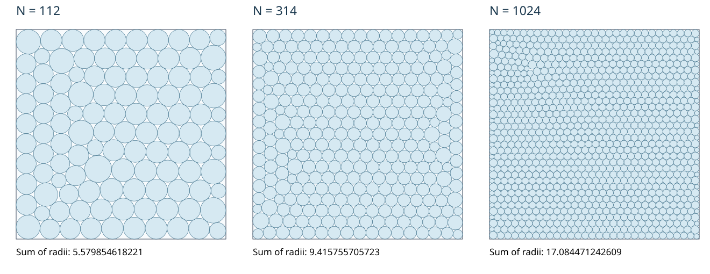

# Circles in a Square

**Audrey Hillenbrand**  
University of Chicago Laboratory Schools High School

I study how to arrange circles of different sizes inside a square so that they do not overlap and the sum of their radii is as large as possible. This repository presents 335 packings from that research: as of Packomania's November 1, 2026 table, 287 beat its posted scores, plus 48 new counts the table does not list. All 335 were submitted to Packomania on November 4, 2026; acceptance is pending.

## The problem

For a fixed number of circles, $N$, the objective is to maximize

$$
S_N = \sum_{i=1}^{N} r_i,
$$

where $r_i$ is the radius of circle $i$. Every circle must fit inside the unit square, and no two circles may overlap.

This differs from maximizing the area covered by the circles. A useful change can make some circles smaller while enlarging others by a greater total amount. Because the circles constrain one another, an improvement in one part of the square may require adjustments elsewhere. Many arrangements resist further improvement even when a better arrangement exists.

## My research

I use a repeated cycle of **research → hypothesis → test → analysis → revision**. I study the problem, identify questions, design comparisons, assess the results, and use what I learn to guide the next experiments.

I direct the research, choose the tests, and assess the evidence. I use Astra, an OpenAI ChatGPT model, to help implement and run project code and analyze the outcomes. The project also uses and adapts published solvers, credited below.

One important lesson is that improving a starting arrangement does not necessarily improve the best known result. I distinguish gains over an experiment's starting point from gains over my retained results and the published benchmark.

## One experiment: choosing where to add circles

I noticed that adding two circles could look especially attractive when both required shrinking the same neighbor: that neighbor loses only the larger of the two required cuts, rather than their sum. This immediate advantage did not reliably predict which arrangement would finish best. I tested a Zero-Shared menu that excluded these pairs, holding the donor packing, candidate-site pool, eight-start allowance, recovery and finishing procedures fixed against the original menus. At N=314, the completed comparison improved the radius sum by 0.000287309 over the strongest control, but the same top-eight policy lost at three of the other five counts. I therefore retained this idea as an additional route alongside the original routes, preserving their results rather than imposing the restriction on every start.

## How the generator works

The generator is a program that creates candidate arrangements and searches for improvements. It took shape through the experiments I selected and evaluated; Astra helped implement the project code, alongside the published tools credited below. It has five main parts:

1. **Construct starting arrangements.** Create rows, triangular patterns and boundary arrangements with different orientations and offsets. This provides several starting points, including for circle counts without an existing packing.
2. **Adapt nearby packings.** Use an arrangement with slightly fewer or more circles as a starting point. Add or remove circles, or split a circle or merge a pair. Selected older arrangements remain useful even after their own scores have been surpassed.
3. **Optimize the whole packing.** Adjust circle centers and radii together. Some circles may shrink while others grow by a greater total amount. Exploratory routes can temporarily lose score while the best saved packing remains available.
4. **Explore contacts and finish.** Change selected touching relationships to allow new movements, then refine promising arrangements. Continue productive searches while keeping unsuccessful alternatives from replacing a better result.
5. **Keep improvements and feed them back.** Check candidate packings, retain the best scores, and use useful new geometries as starting points for other counts. Records of completed experiments help avoid repeating identical work.

Different circle counts benefit from different arrangements and search routes. The generator combines these parts to explore several possibilities and retain the strongest result found.

## Results

The comparisons use Packomania's table downloaded on **November 1, 2026**.

| Category | Number of circle counts |
|---|---:|
| Scores exceeding the website by more than 0.000001 | 287 |
| Counts absent from that website snapshot | 48 |
| Total included | 335 |

The initial release included 39 of the 48 unlisted counts found in this project. After additional contact finishing and construction, the remaining nine now meet the submission's 3N-contact criterion and are included here.

The 0.000001 threshold is my reporting cutoff, not a stated Packomania acceptance rule. These are computational results, not proofs of global optimality. The 48 unlisted counts are potential additions to the website, rather than claims that those counts have never been studied.

The largest absolute leads in this release are:

| N | Radius sum, rounded | Website sum | Difference, rounded |
|---:|---:|---:|---:|
| 7396 | 46.091252476015 | 46.035967997707 | +0.055284478308 |
| 9801 | 53.068829058133 | 53.015624816539 | +0.053204241594 |
| 5041 | 38.022949097220 | 37.975219102505 | +0.047729994715 |
| 1024 | 17.084471242609 | 17.059358817280 | +0.025112425329 |
| 7744 | 47.154533578632 | 47.130009798205 | +0.024523780427 |

The GitHub release and accompanying Packomania submission contain the same 335 packing files.

## Verify it yourself

Run `python3 verify_pck.py --all` from the repository folder; it uses Python 3.9 or later and no extra packages, and prints PASS or FAIL for each file.
The checker reads the stored decimals as exact rational numbers, checks containment and non-overlap, and compares the exact radius sums with `data/RESULTS.csv`.
Contact proximity is reported separately using a strict gap below 3e-12; it never permits overlap. These checks do not prove global optimality or establish website acceptance.

## Acknowledgments

Packomania, maintained by Eckard Specht, provided benchmark tables and published coordinates credited to its contributing record holders. Jason Liang's published packings and circle-packing solvers provided additional starting points and optimization tools. The adaptive-jam finishing branch uses a project implementation derived from Arnold Castro's adaptive-box method. These contributions are distinct from my experiment design and assessment of the results.

## Release and submission status

Repository created and initial results committed: November 4, 2026. Benchmark snapshot: November 1, 2026.
Submitted to Packomania on November 4, 2026; acceptance pending.

## Data license

My contributions to the packing data and score tables are available under the Creative Commons Attribution 4.0 International license (CC BY 4.0). Please credit Audrey Hillenbrand, Circles in a Square, and identify any changes. Third-party rights and source credits remain applicable; see LICENSE.
